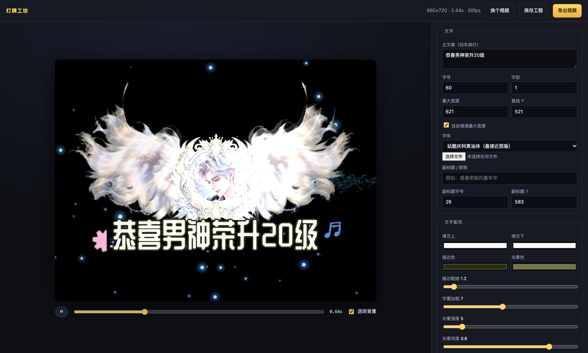

# 灯牌工坊 · Light Badge Studio

> 上传一段灯牌/升级特效视频 → 自动逆向出它的动态效果 → **文字、头像、字体**变成可编辑的 → 一键出片。

[](https://github.com/kongchengccc/light-badge-studio/actions/workflows/ci.yml)
[](https://github.com/kongchengccc/light-badge-studio/actions/workflows/deploy-pages.yml)



---

## 它解决什么问题

抖音直播的「升级灯牌 / 进场特效」要交的是 **带 Alpha 透明通道的 MOV**。
网上下载的素材文字写死了，剪映里自己加字又很难对齐样式，做一个同款往往要花半天。

灯牌工坊把这件事变成三步：

1. **上传**你手头那段视频（哪怕是从别处存下来的）
2. 系统 **自动逆向**：抠出美术主体、量出羽毛怎么摆、粒子往哪飘、文字什么配色
3. 在网页里 **改字、换头像、换字体**，导出 MP4 / ProRes 4444 透明 MOV / GIF / PNG 序列

---

## 逆向引擎做了什么

| 环节 | 做法 | 关键点 |
|---|---|---|
| **美术层分离** | 时间 75 分位做参考帧 → 亮度抠像 → 蓝色瞬时粒子抑制 → 黄绿辉光剥离 → 连通域去噪 | 参考帧用 75 分位而不是中值，否则细羽毛会被压暗抠不出来 |
| **文字区域检测** | 全宽「很亮像素」行剖面找台阶 | 文字是画面最亮的一批像素，在下半场形成一个明显的密度台阶，比颜色/色相可靠得多 |
| **文字剥离** | 只抠文字字形本身的亮像素 + 一点膨胀 | **绝不做矩形切割** —— 那样会把吊坠、羽尖一起切掉（这是踩过的坑） |
| **运动场测量** | 逐块相对参考帧的位移轨迹 → 频率扫描 → 正弦拟合出 4 通道 (ax,bx,ay,by) | 存成粗网格，前端双线性插值逐像素还原，**不套解析公式**，不规则抖动也保得住 |
| **粒子流测量** | 纯背景区的 Farneback 光流取中位 | 相位相关会被美术边缘的高光带偏 |
| **头像区域** | 美术中央的低纹理连通区 + 椭圆拟合 | 也可以在界面上直接换图 |
| **文字样式采样** | 从原文字区反推填充渐变 / 描边色 / 辉光色 / 字号 | |
| **装饰图标** | 文字带左右两侧的饱和小色块 | 星星、音符会单独导出并从美术层挖掉 |

分析一次约 **20~60 秒**（取决于视频长度），结果存成 `project.json` + 若干 PNG。

---

## 快速开始

### ⭐ 最省事：本地双击运行（**不用注册任何网站、不用云服务**）

```bash
双击「启动灯牌工坊.command」
```

浏览器会自动打开 <http://127.0.0.1:8000>，就能用了。
首次会自动建虚拟环境装依赖（2~5 分钟），之后秒开。

- 视频分析、编辑、导出 MOV 全部在**你自己的 Mac** 上跑，不上传、不联网、不花钱
- 依赖：Python 3.11+ / ffmpeg / Chrome（脚本会检查并提示）
- 关掉终端窗口就停服务

> 想让家里/公司/手机都能访问，再看下面的云部署（可选）。

### 本地跑（手动）

```bash
git clone <repo>
cd <repo>
python3 -m venv .venv && source .venv/bin/activate
pip install -r requirements.txt

# 还需要系统里有 ffmpeg 和 Chrome/Chromium（服务端渲染要用）
#   macOS: brew install ffmpeg
#   Ubuntu: sudo apt install ffmpeg chromium

uvicorn backend.app:app --reload --port 8000
```

打开 http://127.0.0.1:8000 → 拖一段视频进去。

### Docker

```bash
docker compose up --build     # → http://127.0.0.1:8000
```

### 部署到云端

| 平台 | 做法 |
|---|---|
| **Render** | 仓库里有 `render.yaml`，在 Render 里 New → Blueprint → 选本仓库即可 |
| **Fly.io** | `fly launch --copy-config --no-deploy && fly deploy` |
| **GitHub Pages（前端）** | 仓库里有 `deploy-pages.yml`，推到 main 即自动部署。Pages 只放前端，后端地址在 `frontend/js/config.js` 里填 |
| **Vercel / Netlify** | 仓库里带了 `vercel.json` / `netlify.toml`，把 `frontend/` 作为根目录 |

前端和后端可以分开部署：前端是纯静态（Pages / Vercel / Netlify 都行），后端是 FastAPI（Render / Fly / 自己的 VPS）。

---

## 目录结构

```
.
├── backend/
│   ├── app.py                 FastAPI 服务（分析 / 工程 / 素材 / 字体 / 服务端渲染）
│   ├── render.py              无头 Chrome 逐帧出图 + ffmpeg 编码
│   ├── analyzer/
│   │   ├── frames.py          抽帧与元信息
│   │   ├── layers.py          美术层 / 粒子 / 辉光 分离
│   │   ├── regions.py         文字带、头像椭圆检测
│   │   ├── motion.py          运动场测量与正弦拟合
│   │   ├── particles.py       粒子流测量
│   │   ├── style.py           文字配色采样
│   │   └── pipeline.py        流水线编排
│   └── samples/demo.mp4       内置示例
├── frontend/
│   ├── index.html             编辑器界面
│   ├── export.html            服务端渲染用的逐帧页面
│   └── js/
│       ├── engine.js          Canvas 渲染引擎（粒子 / warp / 流光 / 文字 / 图标）
│       ├── editor.js          UI 逻辑
│       ├── api.js             API 封装
│       └── config.js          后端地址配置
├── cli/analyze.py             命令行版分析器（不起服务也能用）
├── tests/                     pytest 单元测试 + 冒烟测试
├── Dockerfile / render.yaml / fly.toml / vercel.json / netlify.toml
└── .github/workflows/         CI + Pages 部署
```

### 命令行版

```bash
python3 cli/analyze.py 你的视频.mp4 输出目录
# 产出 assets/*.png + project.json
```

---

## API

| 方法 | 路径 | 说明 |
|---|---|---|
| POST | `/api/analyze` | 上传视频（multipart），异步分析，返回 `{id, job}` |
| GET | `/api/jobs/{job}` | 任务进度 `{step, percent, done, error}` |
| GET | `/api/projects/{id}` | 取工程 JSON |
| PUT | `/api/projects/{id}` | 保存工程 |
| GET | `/api/projects/{id}/file/{path}` | 取素材（badge/avatar/icons） |
| GET | `/api/fonts` | 可用字体列表 |
| GET | `/api/sample` | 内置示例 |
| POST | `/api/projects/{id}/render` | 服务端渲染（mp4 / mov / webm / gif） |
| GET | `/api/health` | 健康检查（ffmpeg / chrome 是否就绪） |
| GET | `/api/docs` | 交互式 API 文档 |

---

## 导出格式

| 格式 | 说明 |
|---|---|
| `mp4` | H.264 黑底，通用（OBS / 剪映 / 微信） |
| `mov` | **ProRes 4444 + Alpha 透明通道** ★ 抖音直播灯牌行业标准 |
| `webm` | VP9 + Alpha（需要 ffmpeg 的 libvpx 编译了 alpha，否则会退化成黑底，脚本会检测并警告） |
| `gif` | 动图，仅预览用（直播别用 GIF，会掉帧） |
| PNG 序列 | 浏览器里直接导出 ZIP |

---

## 推到 GitHub

仓库已经 `git init` 并提交好了（`.git` 也在里面），只需要加个远端再推：

```bash
cd 灯牌工坊

# 仓库已建好，直接推
git remote add origin git@github.com:kongchengccc/light-badge-studio.git
git push -u origin main
```

（这台机器的 SSH 公钥已经绑到 `kongchengccc`，所以走 SSH 不需要 token。）

推上去之后：
- **CI**（`.github/workflows/ci.yml`）会在每次 push 跑 pytest + 冒烟测试
- **前端**（`.github/workflows/deploy-pages.yml`）会自动部署到 GitHub Pages，
  地址在仓库的 Settings → Pages 里能看到
- **后端**用 Render / Fly 部署（仓库里有 `render.yaml` / `fly.toml`）
- Pages 只放前端，后端地址在 `frontend/js/config.js` 里填：

  ```js
  window.API_BASE = "https://light-badge-studio.onrender.com";  // 换成你后端实际的地址
  ```

  填完再推一次，前端就连上后端了

---

## 授权

- 代码：MIT（见 `LICENSE`）
- 站酷庆科黄油体：SIL Open Font License 1.1，可商用
- 分析出来的美术素材归**上传视频的所有者**所有，请自行确认原始素材的授权范围

## 已知限制

- 自动检测是**尽力而为**：不同风格的灯牌（不同的美术配色、不同的文字位置）可能需要手动微调，
  界面上每个参数都能改，改完可以「保存工程」
- 视频里被文字完全遮住的那部分美术无法恢复（源文件里就没有），只能靠文字本身遮住
- 服务端渲染依赖 Chrome 和 ffmpeg，容器里已装好；本地跑需要自己装
